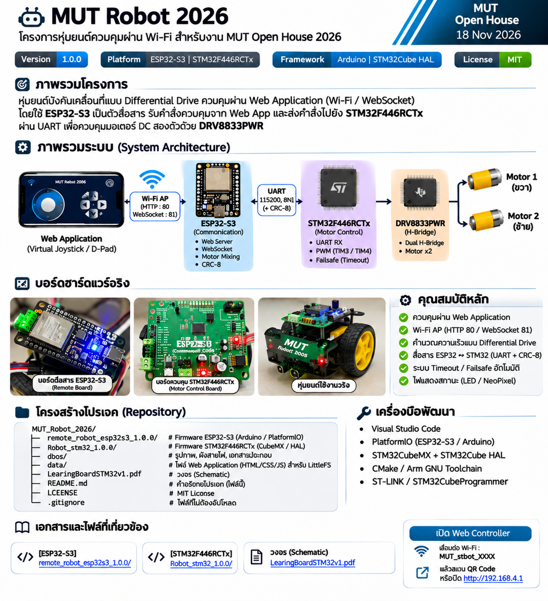
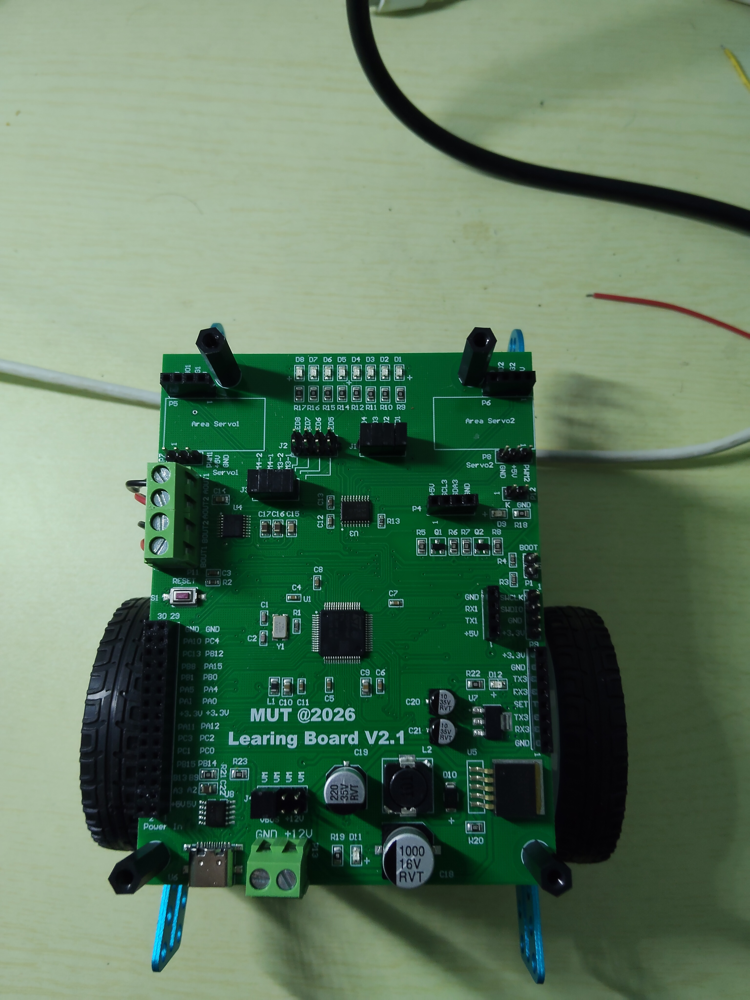

# 🤖 MUT Robot 2026


หุ่นยนต์บังคับผ่าน **Wi-Fi / Web Controller (HTTP + WebSocket)** สำหรับงาน **MUT Robot Open House 2026 (18 พฤศจิกายน 2026)** พัฒนาด้วยไมโครคอนโทรลเลอร์ 2 ตัวที่แบ่งหน้าที่กัน ได้แก่ **ESP32-S3** สำหรับให้บริการ Web App และรับคำสั่งควบคุมผ่าน WebSocket และ **STM32F446RCTx** สำหรับควบคุมมอเตอร์ DC ผ่าน **DRV8833PWR**

## 📸 ภาพรวมระบบ



> ภาพประกอบระบบจัดทำจากภาพถ่ายบอร์ดจริง เพื่ออธิบายสถาปัตยกรรมโดยรวม การต่อสายจริงให้ยึดตามวงจรและการตรวจสอบบนฮาร์ดแวร์

## 🔧 Firmware และเครื่องมือพัฒนา

| ส่วนควบคุม | หน้าที่ | เครื่องมือพัฒนา |
|---|---|---|
| [**ESP32-S3**](remote_robot_esp32s3_1.0.0/README.md) | Wi-Fi AP, HTTP Port 80, WebSocket Port 81, LittleFS Web App, Joystick, Differential Drive, UART และ NeoPixel | **VS Code + PlatformIO + Arduino** |
| [**STM32F446RCTx**](Robot_stm32_1.0.0/README.md) | UART RX, CRC-8, PWM TIM3/TIM4, DRV8833 และ Motor Failsafe | **VS Code + STM32CubeMX + CMake + STM32Cube HAL** |

### การทำงานร่วมกัน

```text
มือถือ / คอมพิวเตอร์ (Web Browser)
           │
       Wi-Fi AP
           │
    HTTP :80 / WebSocket :81
           │
           ▼
       ESP32-S3 N16R8
  LittleFS (HTML / CSS / JS)
  Joystick / D-Pad → X,Y
  Differential Drive + CRC-8
           │
      UART1 115200 8N1
      Packet 8 bytes
           │
           ▼
       STM32F446RCTx
           │
       TIM3 / TIM4 PWM
           │
        DRV8833PWR
           │
       DC Motor × 2
```
- **Wi-Fi AP Connection Limit:** จำกัดการเชื่อมต่อ Wi-Fi AP สูงสุด **1 Device** ต่อหุ่นยนต์ เมื่ออุปกรณ์เดิมตัดการเชื่อมต่อ ระบบจึงเปิดรับอุปกรณ์ใหม่ โดย WebSocket จำกัด Active Controller ไว้ที่ 1 Connection
- **ESP32-S3 → STM32:** Packet 8 ไบต์, Header `0xA5`, คำสั่ง `0x01` Motor / `0x02` Stop / `0x03` Heartbeat และ CRC-8 Polynomial `0x07`
- **ESP32-S3 Failsafe:** Joystick Timeout `350 ms`, ส่ง STOP เมื่อปล่อย Joystick หรือ WebSocket หลุด และส่ง STOP/Heartbeat เป็นระยะทุก `100 ms` ตามสถานะ
- **STM32 Failsafe:** Motor Command Timeout `500 ms` โดย Heartbeat ไม่ต่ออายุการขับเคลื่อน
- **การควบคุม:** รับ `[X,Y]` ผ่าน WebSocket โดย `X` เป็นเดินหน้า/ถอยหลัง และ `Y` เป็นเลี้ยวซ้าย/ขวา; จำกัดผู้ควบคุมที่ใช้งานพร้อมกันหนึ่งราย

## 🌐 Web Controller (ระบบปัจจุบัน)

Web App จัดเก็บอยู่ใน **LittleFS** ของ ESP32-S3 ประกอบด้วย HTML, CSS และ JavaScript จึงไม่ต้องติดตั้งแอป Android เพื่อควบคุมหุ่นยนต์

| รายการ | การตั้งค่า |
|---|---|
| Wi-Fi Mode | Access Point (AP) |
| SSID | `MUT_robot_XXXX` (สร้างจาก eFuse MAC) |
| Password | `12345678` |
| Wi-Fi Channel | 1 |
| Maximum AP Clients | 1 Device |
| Maximum Active WebSocket Controller | 1 Connection |
| AP IP เริ่มต้น | `192.168.4.1` |
| Web Interface | `http://192.168.4.1/` (HTTP Port `80`) |
| WebSocket | Port `81` |
| Web Assets | `data/index.html`, `data/style.css`, `data/app.js` |
| PWA Manifest | `data/manifest.webmanifest` (ขอแสดงผลแนวนอนเมื่อรองรับ) |

### วิธีใช้งาน

1. เปิดหุ่นยนต์และรอให้ ESP32-S3 เปิด Wi-Fi AP
2. เชื่อมต่อมือถือหรือคอมพิวเตอร์กับ `MUT_robot_XXXX` โดยใช้รหัสผ่าน `12345678`
3. เปิดเบราว์เซอร์ไปที่ **`http://192.168.4.1/`**
4. ใช้ **Virtual Joystick** หรือ **D-Pad** ควบคุมทิศทาง และปรับความเร็วด้วย Slider
5. ปล่อยปุ่มหรือ Joystick เพื่อส่งคำสั่งหยุด ตรวจสอบสถานะการเชื่อมต่อก่อนใช้งานจริง

> **หมายเหตุ:** Web App ออกแบบสำหรับการใช้งานแนวนอน (Landscape) และมี PWA Manifest แต่การบังคับหมุนหน้าจอขึ้นอยู่กับเบราว์เซอร์และวิธีเปิดใช้งาน ไม่รับประกันว่าเบราว์เซอร์ทุกตัวจะล็อกแนวนอนได้

### การอัปโหลด Firmware และ Web App

เปิดโฟลเดอร์ `remote_robot_esp32s3_1.0.0/` ใน VS Code + PlatformIO แล้วใช้คำสั่ง:

```bash
pio run
pio run -t upload
pio run -t uploadfs
pio device monitor -b 115200
```

> **สำคัญ:** เมื่อแก้ไฟล์ในโฟลเดอร์ `data/` ต้องอัปโหลด LittleFS ใหม่ด้วย `pio run -t uploadfs` โดยใช้ Partition Scheme ที่รองรับ LittleFS ตาม `platformio.ini` ของโปรเจกต์จริง

### รูปแบบคำสั่งควบคุม

WebSocket ส่งข้อความข้อความรูปแบบ `[X,Y]` โดยแต่ละแกนเป็นจำนวนเต็ม `-100` ถึง `100` เช่น:

| คำสั่ง | ความหมาย |
|---|---|
| `[100,0]` | เดินหน้า |
| `[-100,0]` | ถอยหลัง |
| `[0,-100]` | เลี้ยวซ้าย |
| `[0,100]` | เลี้ยวขวา |
| `[0,0]` | หยุด |

ESP32-S3 คำนวณความเร็วมอเตอร์ด้วย `left = x + y` และ `right = x - y` พร้อม Normalize ให้ไม่เกิน 100% ก่อนส่ง UART Packet ไปยัง STM32

## 📱 Web Application — QR Code Access

ควบคุมหุ่นยนต์ผ่าน **Web Application** โดยไม่จำเป็นต้องติดตั้งแอปพลิเคชัน Android หรือ iOS

Web Controller รองรับ **Virtual Joystick, D-Pad และ Speed Control** พร้อมการแสดงผลแบบ Landscape สำหรับการควบคุมหุ่นยนต์

### 🌐 วิธีเข้าใช้งาน

1. เชื่อมต่อ Wi-Fi ของหุ่นยนต์ `MUT_robot_XXXX`
2. สแกน QR Code ด้านล่างเพื่อเปิด Web Controller
3. ใช้ Joystick หรือ D-Pad เพื่อควบคุมการเคลื่อนที่

**Web Controller URL:** `http://192.168.4.1`

### 📷 QR Code — Web Controller

<p align="center">
  
</p>


> **หมายเหตุ:** QR Code ใช้สำหรับเปิด Web Controller หลังจากเชื่อมต่อ Wi-Fi ของหุ่นยนต์แล้ว โดยระบบสื่อสารผ่าน WebSocket Port 81 และ HTTP Port 80

## 🛠️ ฮาร์ดแวร์และเอกสาร

### บอร์ดที่ใช้งานจริง





### เอกสารวงจร

- [Schematic — Learning Board STM32 (PDF)](LearingBoardSTM32v1.pdf)


### 🔌 ผังการต่อสายไฟ (Wiring Diagram)

แผนผังการเชื่อมต่อระหว่าง ESP32-S3, STM32F446RCTx,
DRV8833PWR และมอเตอร์ DC ทั้งสองตัว


**Motor Connections (DRV8833PWR)**
- `AOUT1 / AOUT2` → Right Motor (Motor 1)
- `BOUT1 / BOUT2` → Left Motor (Motor 2)

**UART Connections**
- ESP32-S3 `GPIO17 (TX)` → STM32 `PA10 (USART1 RX)`
- ESP32-S3 `GPIO18 (RX)` ← STM32 `PA9 (USART1 TX)` (Optional)
- `GND` → Common Ground

> ปัจจุบัน Firmware ใช้ UART จาก ESP32-S3 ไป STM32 เป็นหลัก
> โดยยังไม่ได้ใช้ UART ขากลับสำหรับการควบคุม


## 📂 โครงสร้าง Repository

```text
MUT_Robot_2026/
├── remote_robot_esp32s3_1.0.0/   # ESP32-S3 / PlatformIO
│   ├── data/                     # Web App (HTML/CSS/JS/Manifest)
│   └── src/main.cpp              # ESP32 Firmware
├── Robot_stm32_1.0.0/           # STM32 / CubeMX + CMake
├── docs/
│   ├── images/                   # ภาพระบบ บอร์ด และ QR Code
│   └── wiring/                   # Wiring Diagram
├── app/                         # Android APK เดิม (Legacy)
├── LearingBoardSTM32v1.pdf      # Schematic บอร์ด
├── .gitignore
├── LICENSE
└── README.md
```

## 🚀 เริ่มต้นศึกษาโปรเจกต์

1. อ่าน [README ฝั่ง ESP32-S3](remote_robot_esp32s3_1.0.0/README.md) เพื่อดูการ Build/Upload Firmware และ LittleFS ด้วย PlatformIO
2. อ่าน [README ฝั่ง STM32](Robot_stm32_1.0.0/README.md) เพื่อดูการตั้งค่า CubeMX, CMake และการควบคุมมอเตอร์
3. ตรวจสอบ Schematic และการเชื่อมต่อไฟเลี้ยง/สัญญาณก่อนทดสอบ โดยเริ่มจาก **ยกล้อให้ลอย**
4. เชื่อมต่อ Wi-Fi AP และเปิด `http://192.168.4.1/` เพื่อทดสอบ Web Controller

## 👨‍🔧 ผู้พัฒนา

**Pakprom Naennoi (Peace)**  
Electronics Engineer (Embedded Systems)  
**เวอร์ชัน:** 1.0.0 · **งาน:** MUT Robot Open House 2026

โครงการก่อนหน้า: [MUT_Robot_L298N (2025)](https://github.com/peacepaul1999/MUT_Robot_L298N)

## 📄 License

โค้ดต้นฉบับของโปรเจกต์เผยแพร่ภายใต้ [**MIT License**](LICENSE) ส่วนไลบรารีและคอมโพเนนต์ภายนอกเป็นไปตาม License ของแต่ละโครงการ
