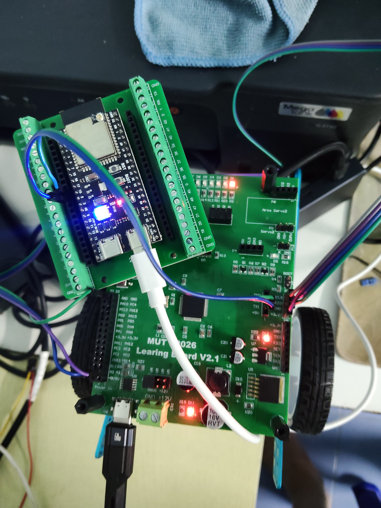
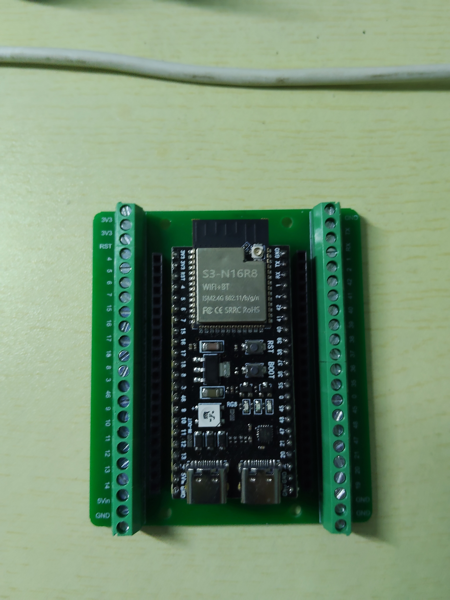
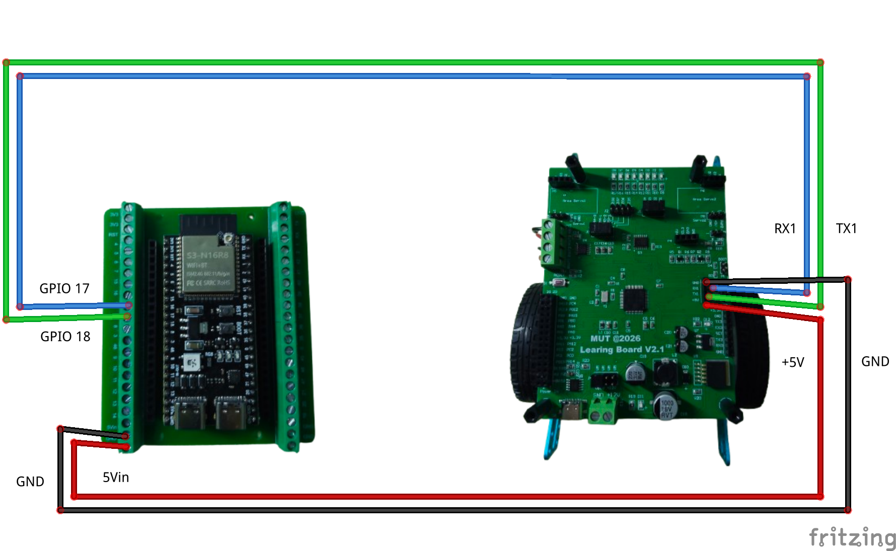

# 🤖 MUT Robot 2026


หุ่นยนต์บังคับผ่าน **Wi-Fi / TCP** สำหรับงาน **MUT Robot Open House 2026 (18 พฤศจิกายน 2026)** พัฒนาด้วยไมโครคอนโทรลเลอร์ 2 ตัวที่แบ่งหน้าที่กัน ได้แก่ **ESP32-S3** สำหรับรับคำสั่งจากแอป และ **STM32F446RCTx** สำหรับควบคุมมอเตอร์ DC ผ่าน **DRV8833PWR**

## 📸 ภาพรวมระบบ


> ภาพประกอบระบบจัดทำจากภาพถ่ายบอร์ดจริง เพื่ออธิบายสถาปัตยกรรมโดยรวม การต่อสายจริงให้ยึดตามวงจรและการตรวจสอบบนฮาร์ดแวร์

## 🔧 Firmware และเครื่องมือพัฒนา

| ส่วนควบคุม | หน้าที่ | เครื่องมือพัฒนา |
|---|---|---|
| [**ESP32-S3**](remote_robot_esp32s3_1.0.0/README.md) | Wi-Fi AP, TCP Port 8080, Joystick, Differential Drive, UART และ NeoPixel | **VS Code + PlatformIO + Arduino** |
| [**STM32F446RCTx**](Robot_stm32_1.0.0/README.md) | UART RX, CRC-8, PWM TIM3/TIM4, DRV8833 และ Motor Failsafe | **VS Code + STM32CubeMX + CMake + STM32Cube HAL** |

### การทำงานร่วมกัน

```text
แอป / Joystick  ──Wi-Fi TCP──>  ESP32-S3
                                    │
                              UART 115200 8N1
                               Packet + CRC-8
                                    │
                                    ▼
                             STM32F446RCTx
                                    │
                              TIM3 / TIM4 PWM
                                    │
                                DRV8833PWR
                                    │
                              DC Motor × 2
```

- **ESP32-S3 → STM32:** Packet 8 ไบต์, Header `0xA5`, คำสั่ง `0x01` Motor / `0x02` Stop / `0x03` Heartbeat
- **ESP32-S3 Failsafe:** Joystick Timeout `350 ms` และส่ง STOP ซ้ำทุก `100 ms` เมื่อหยุด
- **STM32 Failsafe:** Motor Command Timeout `500 ms` โดย Heartbeat ไม่ต่ออายุการขับเคลื่อน


## 📱 Android Application

<p align="center">
  
</p>

แอปพลิเคชันสำหรับควบคุมหุ่นยนต์ผ่าน Wi-Fi / TCP

**ดาวน์โหลดแอปพลิเคชัน Android**

[📥 ดาวน์โหลด Robot Controller APK (Google Drive)](https://drive.google.com/file/d/1SmlgpZTPX4050RUFfEwLvRmpuiBsYC0t/view?usp=drive_link)

**สแกน QR Code เพื่อดาวน์โหลด**

<p align="center">
  
</p>

### วิธีใช้งาน

1. ดาวน์โหลดและติดตั้งไฟล์ APK บนอุปกรณ์ Android
2. เชื่อมต่อ Wi-Fi ของหุ่นยนต์ (`MUT_robot_XXXX`)
3. เปิดแอปและเชื่อมต่อกับ ESP32-S3
4. ใช้ Joystick ควบคุมการเคลื่อนที่และหยุดหุ่นยนต์

## 🛠️ ฮาร์ดแวร์และเอกสาร

### บอร์ดที่ใช้งานจริง






### เอกสารวงจร

- [Schematic — Learning Board STM32 (PDF)](LearingBoardSTM32v1.pdf)


### 🔌 ผังการต่อสายไฟ (Wiring Diagram)

แผนผังการเชื่อมต่อระหว่าง ESP32-S3, STM32F446RCTx,
DRV8833PWR และมอเตอร์ DC ทั้งสองตัว



**Motor Connections (DRV8833PWR)**
- `AOUT1 / AOUT2` → Right Motor (Motor 1)
- `BOUT1 / BOUT2` → Left Motor (Motor 2)

**UART Connections**
- ESP32-S3 `GPIO17 (TX)` → STM32 `PA10 (USART1 RX)`
- ESP32-S3 `GPIO18 (RX)` ← STM32 `PA9 (USART1 TX)` (Optional)
- `GND` → Common Ground

> ปัจจุบัน Firmware ใช้ UART จาก ESP32-S3 ไป STM32 เป็นหลัก
> โดยยังไม่ได้ใช้ UART ขากลับสำหรับการควบคุม


## 📂 โครงสร้าง Repository

```text
MUT_Robot_2026/
├── remote_robot_esp32s3_1.0.0/   # ESP32-S3 / PlatformIO
├── Robot_stm32_1.0.0/           # STM32 / CubeMX + CMake
├── docs/
│   ├── images/
│   │   ├── mut_robot_2026_overview.png
│   │   └── robot_hardware_real.jpg
│   └── wiring/                  # เพิ่มผังสายไฟภายหลัง
├── LearingBoardSTM32v1.pdf      # Schematic บอร์ด
├── .gitignore
├── LICENSE
└── README.md
```

## 🚀 เริ่มต้นศึกษาโปรเจกต์

1. อ่าน [README ฝั่ง ESP32-S3](remote_robot_esp32s3_1.0.0/README.md) เพื่อดูการ Build/Upload ด้วย PlatformIO
2. อ่าน [README ฝั่ง STM32](Robot_stm32_1.0.0/README.md) เพื่อดูการตั้งค่า CubeMX, CMake และการควบคุมมอเตอร์
3. ตรวจสอบ Schematic และการเชื่อมต่อไฟเลี้ยง/สัญญาณก่อนทดสอบ โดยเริ่มจาก **ยกล้อให้ลอย**

## 👨‍🔧 ผู้พัฒนา

**Pakprom Naennoi (Peace)**  
Electronics Engineer (Embedded Systems)  
**เวอร์ชัน:** 1.0.0 · **งาน:** MUT Robot Open House 2026

โครงการก่อนหน้า: [MUT_Robot_L298N (2025)](https://github.com/peacepaul1999/MUT_Robot_L298N)

## 📄 License

โค้ดต้นฉบับของโปรเจกต์เผยแพร่ภายใต้ [**MIT License**](LICENSE) ส่วนไลบรารีและคอมโพเนนต์ภายนอกเป็นไปตาม License ของแต่ละโครงการ
