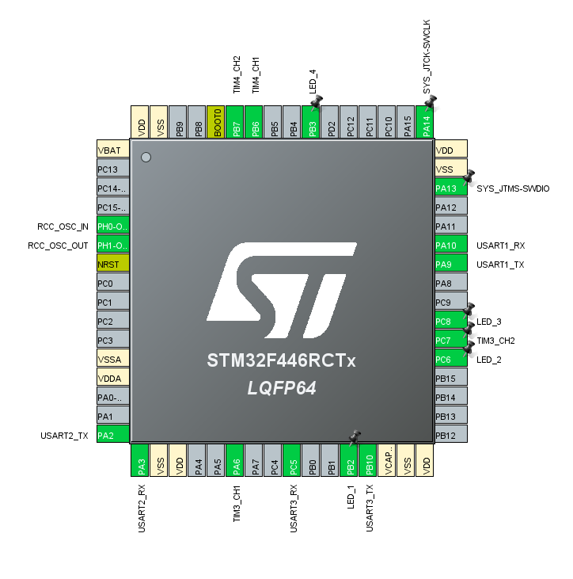
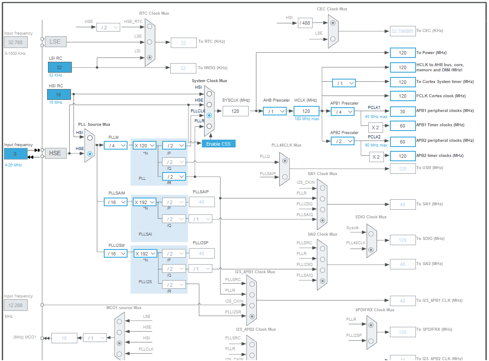
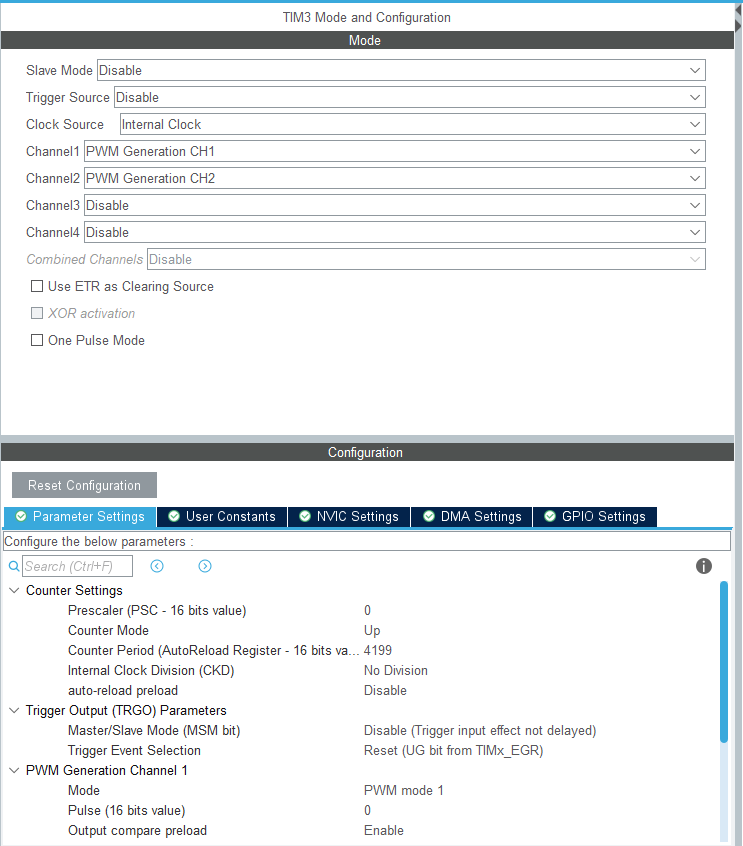
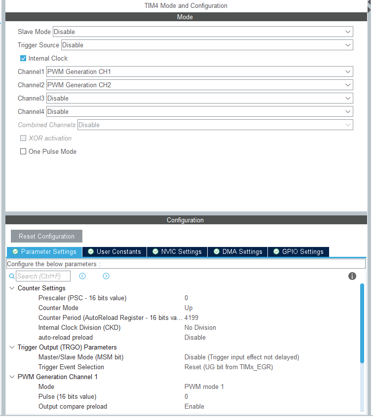
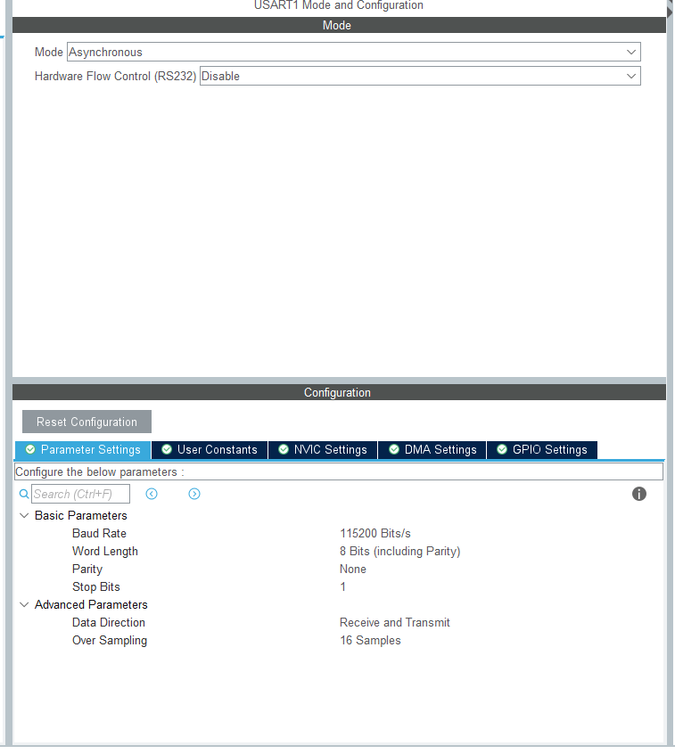
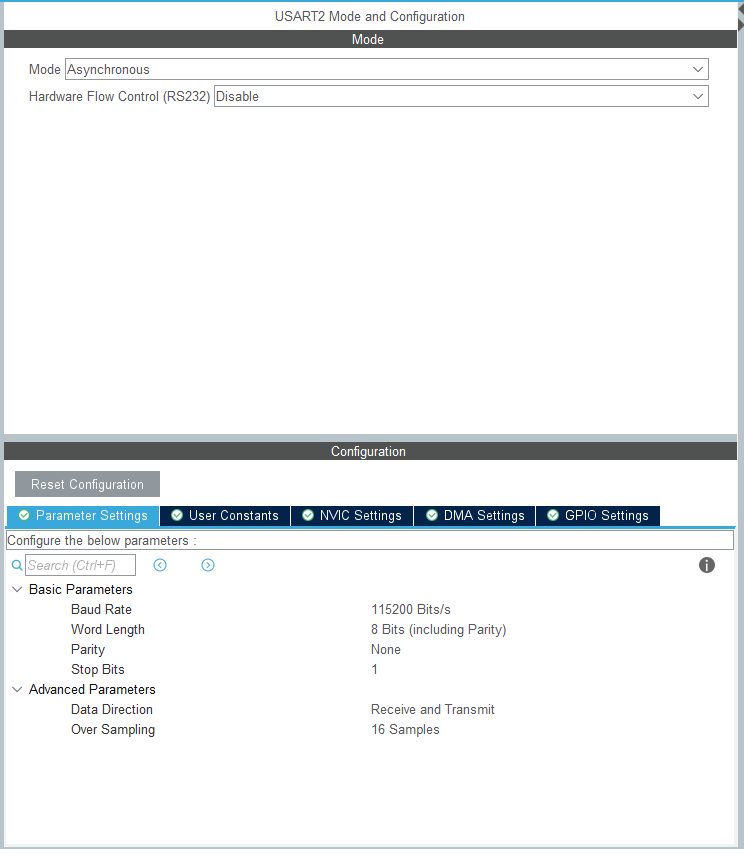

# 🤖 MUT Robot 2026 — STM32F446RCTx Motor Controller

  

เฟิร์มแวร์สำหรับ **STM32F446RCTx** ทำหน้าที่รับคำสั่งควบคุมมอเตอร์จาก **ESP32-S3** ผ่าน UART ตรวจสอบความสมบูรณ์ของ Packet ด้วย CRC-8 และสร้างสัญญาณ PWM ควบคุมมอเตอร์ DC สองตัวผ่าน **DRV8833PWR Dual H-Bridge** พร้อม Motor Timeout, Debug UART และ LED Status

พัฒนาสำหรับงาน **MUT Robot Open House 2026 (18 November 2026)**

> **Architecture:** STM32 เป็น Motor Controller โดยตรง; ESP32-S3 เป็น Wi-Fi/TCP Communication Controller ที่ส่ง Motor Command ให้ STM32 ผ่าน UART

## ✨ Features / คุณสมบัติ

- ควบคุมมอเตอร์ DC **2 ตัว** ผ่าน **DRV8833PWR**
- สร้าง PWM ด้วย **TIM3 CH1/CH2** สำหรับ Motor 1 และ **TIM4 CH1/CH2** สำหรับ Motor 2
- กำหนดความเร็วมอเตอร์ **0–100%** พร้อม Forward / Reverse / Coast
- รับคำสั่งผ่าน **USART1** ที่ 115200 baud แบบ **Polling**
- ตรวจสอบ UART Packet **8 bytes** ด้วย CRC-8 (poly `0x07`)
- รองรับ Command `0x01` MOTOR, `0x02` STOP, `0x03` HEARTBEAT
- **Motor Command Timeout 500 ms**: หยุดมอเตอร์เมื่อขาดคำสั่ง MOTOR ล่าสุด
- Heartbeat **ไม่** ต่ออายุ Motor Command Timeout
- USART2 สำหรับ Debug ผ่าน `printf()`
- LED 4 ดวงแสดงสถานะระบบ, UART และมอเตอร์

## 🧠 System Architecture

```text
 Android App / Joystick
           |
       Wi-Fi / TCP
           |
       ESP32-S3
   Differential Drive
           |
     UART 115200 8N1
           |
  STM32F446RCTx USART1
           |
     UART RX Polling
           |
   CRC-8 + Command Parser
           |
   Motor Control + Failsafe
           |
     TIM3       TIM4
    CH1/CH2    CH1/CH2
           \    /
          DRV8833PWR
           /    \
      Motor 1  Motor 2

 USART2 ---> USB-UART / Serial Monitor (Debug)
 GPIO LEDs ---> System / RX / M1 / M2 Status
```

## 🛠 Hardware / ฮาร์ดแวร์

| Component | Description |
|---|---|
| Main MCU | STM32F446RCTx |
| Communication MCU | ESP32-S3 N16R8 |
| Motor Driver | DRV8833PWR Dual H-Bridge |
| Motors | 2 × DC Motors |
| PWM Peripheral | TIM3, TIM4 |
| Communication | USART1 (RX via Polling) |
| Debug Interface | USART2 (`printf`) |
| Status | 4 × LED Outputs |

### 🔌 MCU Connections

| STM32 Peripheral / Pin | Connection | Purpose |
|---|---|---|
| PA10 / USART1 RX | ESP32-S3 GPIO17 TX | Receive Motor Control Packets |
| PA9 / USART1 TX | ESP32-S3 GPIO18 RX (optional) | Optional return UART connection, unused by current control logic |
| GND | ESP32 GND | Common signal ground |
| TIM3 CH1 | DRV8833 Motor 1 input A | PWM Motor 1 |
| TIM3 CH2 | DRV8833 Motor 1 input B | PWM Motor 1 |
| TIM4 CH1 | DRV8833 Motor 2 input A | PWM Motor 2 |
| TIM4 CH2 | DRV8833 Motor 2 input B | PWM Motor 2 |
| USART2 | Debug serial adapter | Firmware log output |

> ขา GPIO จริงของ TIM3/TIM4 และ USART2 ให้ยึดตามไฟล์ `.ioc` / Pinout ของบอร์ดที่ใช้งาน เนื่องจากโค้ด `main.c` ใช้ Timer Channel และ UART Handle โดยไม่ได้ระบุ Alternate Function Pin Mapping ไว้ในส่วนนี้

**Important:** UART เป็นระดับสัญญาณ **3.3V TTL** และต้องต่อ GND ร่วมกัน แหล่งจ่าย **VM ของ DRV8833** ต้องเหมาะกับ Motor และพิกัด Driver ห้ามใช้แรงดันผิดพิกัด

## ⚙️ Peripheral Configuration

| Peripheral | Configuration / Role |
|---|---|
| SYSCLK | 120 MHz (configuration in `main.c`) |
| TIM3 CH1/CH2 | Motor 1 PWM |
| TIM4 CH1/CH2 | Motor 2 PWM |
| USART1 | 115200 baud, 8N1, RX Polling |
| USART2 | Debug output with `printf()` |
| CRC | CRC-8 software implementation |
| Motor Timeout | `500 ms` |
| UART Frame Gap | `20 ms` |
| UART Debug Stats | Disabled by default (`UART_DEBUG_STATS 0`) |

PWM Duty ถูกแปลงจาก Speed 0–100% โดยใช้ `ARR` ของ Timer ที่ CubeMX กำหนด การตั้งค่า Prescaler/Period และความถี่ PWM จริงให้ตรวจจาก `tim.c` / `.ioc` ที่ใช้ Build


## 📸 STM32CubeMX Configuration

STM32F446RCTx peripheral configuration for the MUT Robot 2026 Motor Controller.

### MCU Pinout Configuration



### System Clock Configuration



### PWM Timer Configuration

**TIM3 — Motor 1**



**TIM4 — Motor 2**



### UART Configuration

**USART1 — ESP32-S3 Communication**



**USART2 — Debug Interface**




## 🔄 UART Communication Protocol

โค้ดนี้ต้องใช้ **Protocol เดียวกับ ESP32-S3 Firmware v1.0.0** โดย Packet ความยาวคงที่ 8 ไบต์

| Byte | Field | Valid Values |
|---|---|---|
| 0 | Header | `0xA5` |
| 1 | Command | `0x01`, `0x02`, `0x03` |
| 2 | Motor 1 Speed | `0–100` |
| 3 | Motor 1 Direction | `0` Coast, `1` Forward, `2` Reverse |
| 4 | Motor 2 Speed | `0–100` |
| 5 | Motor 2 Direction | `0` Coast, `1` Forward, `2` Reverse |
| 6 | Reserved | `0x00` |
| 7 | CRC-8 | Poly `0x07`, init `0x00`, over bytes 0–6 |

CRC-8 ไม่สะท้อนบิต (non-reflected), ไม่มี final XOR

### Supported Commands

| Command | Hex | STM32 Behavior |
|---|---|---|
| `CMD_SET_MOTOR` | `0x01` | Validate fields; apply motor speeds/directions; update motor command timestamp |
| `CMD_STOP` | `0x02` | Immediately stop both motors; clear active movement state |
| `CMD_HEARTBEAT` | `0x03` | Communication heartbeat only; does **not** extend Motor Timeout |

**ไม่มีคำสั่ง `CMD_SET_MOTOR_XY (0x04)` ใน Protocol ที่ใช้งานจริง**

> ESP32-S3 ส่งข้อมูล **Motor Speed / Direction** หลังคำนวณ Differential Drive แล้ว ไม่ได้ส่งค่า Joystick X/Y ต้นฉบับ STM32 จึงแสดงค่า Motor ได้ แต่ไม่ควรอ้างว่าได้รับ X/Y ต้นฉบับจาก Packet นี้

## ⚡ Motor Control Logic

การควบคุมมอเตอร์หนึ่งตัวใช้ PWM สองช่องสำหรับ H-Bridge:

| Direction | Input A PWM | Input B PWM | Behavior |
|---|---|---|---|
| `MOTOR_COAST (0)` | 0 | 0 | Coast / Stop |
| `MOTOR_FORWARD (1)` | Duty | 0 | Forward |
| `MOTOR_REVERSE (2)` | 0 | Duty | Reverse |

- จำกัด Speed ไม่เกิน 100%
- `Motor_Set()` คำนวณค่า Compare จาก Timer `ARR`
- `Motor_StopAll()` ตั้ง Duty ทั้งสี่ช่องเป็นศูนย์
- Driver และทิศทางที่เกิดขึ้นจริงขึ้นอยู่กับการต่อสาย Motor ด้วย

## 🛡 Motor Failsafe

- STM32 ใช้ตัวแปรเวลาที่ได้รับ **Motor Command ล่าสุด** เพื่อตรวจสอบ Timeout
- เมื่อไม่มี Motor Command ใหม่ภายใน **500 ms** ขณะที่มอเตอร์ทำงาน จะเรียก `Motor_StopAll()`
- `CMD_HEARTBEAT` ไม่รีเซ็ตการนับ Motor Timeout
- `CMD_STOP` ทำให้มอเตอร์หยุดทันที
- Packet ที่ CRC ผิดจะไม่ถูกส่งเข้า Command Parser
- UART Receive ใช้ **Polling** ตาม Firmware ที่ทดสอบรับข้อมูลได้แล้ว ไม่เปลี่ยนไปใช้ Interrupt โดยอัตโนมัติ

## 💡 LED Status

| LED | Function |
|---|---|
| LED1 | System Ready |
| LED2 | UART Receive Indicator (active ~50 ms) |
| LED3 | Motor 1 Active (Speed > 0) |
| LED4 | Motor 2 Active (Speed > 0) |

การต่อขา LED จริงอ้างอิง `LED_1` ถึง `LED_4` ใน `gpio.h`/`.ioc`

## 🖥 UART Debug (USART2)

ข้อความสถานะถูกส่งผ่าน `printf()` ซึ่ง Retarget ไปยัง USART2

ตัวอย่างรูปแบบ Log ที่ Firmware ใช้งาน:

```text
============================
 STM32 MOTOR CONTROLLER
 SYSCLK: 120000000 Hz
 DRIVER: DRV8833
 UART1: ESP32 RX (POLLING)
 UART2: DEBUG
============================
[SYSTEM] READY
[SYSTEM] INITIALIZED
[SYSTEM] COMPLETE
[MOTOR] M1:100% DIR:1 | M2:-16% DIR:2
[MOTOR] STOP ALL (UART CMD)
```

> ค่า Speed / Direction ที่แสดงเป็นเพียงตัวอย่าง ให้ยึด Log จริงจากบอร์ดหลัง Flash ส่วนการเปิดสถิติ UART สามารถตั้ง `UART_DEBUG_STATS` เป็น `1` ได้

เมื่อเปิด UART Statistics จะมี Counter เช่น:

```text
[UART1] bytes=... valid=... crc_err=... uart_err=...
```

---

## 🧰 Development Tools & Environment

This firmware was developed using **Visual Studio Code, STM32CubeMX, and CMake**, with the STM32Cube HAL framework.

The project uses a CMake-based build system instead of relying on STM32CubeIDE as the primary development environment.

### Development Tools

| Tool | Purpose |
|---|---|
| **Visual Studio Code** | Main IDE for firmware development, debugging, and Git integration |
| **STM32CubeMX** | MCU configuration, GPIO, clock, peripheral initialization, and code generation |
| **CMake** | Build system configuration and project management |
| **Arm GNU Toolchain** | Cross-compilation for ARM Cortex-M microcontrollers |
| **Ninja / Make** | Build execution using the configured CMake generator |
| **STM32Cube HAL** | Hardware abstraction layer and peripheral drivers |
| **ST-LINK / STM32CubeProgrammer** | Firmware flashing and hardware debugging |

### Development Workflow

```text
STM32CubeMX (.ioc)
       |
       v
Peripheral Configuration
(GPIO / Clock / TIM / UART)
       |
       v
Generate Code (CMake Project)
       |
       v
Visual Studio Code
(C / STM32 HAL)
       |
       v
CMake Configure
       |
       v
Build Firmware
(Arm GNU Toolchain)
       |
       v
Flash STM32
(ST-LINK)
       |
       v
Test & Debug
(UART / Serial Monitor)
```

### Recommended VS Code Extensions

| Extension | Purpose |
|---|---|
| **C/C++ (Microsoft)** | C/C++ IntelliSense and debugging support |
| **CMake Tools (Microsoft)** | CMake configuration and build integration |
| **STM32 VS Code Extension (STMicroelectronics)** | STM32 project development and debugging integration |

### Build Using CMake

Configure the project:

```bash
cmake -S . -B build -G Ninja
```

Build the firmware:

```bash
cmake --build build
```

> **Note:** The Arm GNU Toolchain, CMake, and Ninja must be installed and accessible in the system environment. The required tools and commands may vary depending on the generated CMake configuration.

---

## 💻 Development & Build

- Language: **C**
- Framework: **STM32Cube HAL**
- Configuration: **STM32CubeMX** (`.ioc`)
- Target: **STM32F446RCTx**
- Main firmware: `Core/Src/main.c`

### Getting Started

1. เปิดโปรเจกต์ STM32 ของคุณและตรวจสอบ MCU / Clock / TIM3 / TIM4 / USART1 / USART2 ตามไฟล์ `.ioc`
2. ตรวจ GPIO ที่ต่อกับ DRV8833 และสถานะ LED
3. ตั้ง USART1 ให้ตรงกับ ESP32-S3 ที่ **115200 8N1**
4. Build และ Flash Firmware ไปยัง STM32F446RCTx
5. เชื่อม ESP32 GPIO17 TX กับ STM32 PA10 RX และต่อ GND ร่วมกัน
6. เปิด Serial Monitor ของ USART2 ที่ Baud Rate ตามค่า Config ของ `usart.c`
7. เชื่อมแอปกับ Wi-Fi AP ของ ESP32 แล้วทดลองเคลื่อนที่และหยุด
8. ตรวจ Log, LED และ Motor Response โดยทดสอบแบบยกล้อก่อน

### STM32CubeMX Code Generation

โค้ดที่เขียนเองควรอยู่ภายในส่วน `/* USER CODE BEGIN ... */` / `/* USER CODE END ... */` และเปิด **Keep User Code when re-generating** เพื่อป้องกันการถูก Generate ทับ

## 🔗 Related Project

- **ESP32-S3 Communication Controller:** รับคำสั่ง Joystick ทาง TCP และส่ง UART Packet มาที่ STM32
- **Previous project (2025):** [MUT_Robot_L298N](https://github.com/peacepaul1999/MUT_Robot_L298N) — ใช้ L298N ไม่ใช่ DRV8833PWR ของโปรเจกต์นี้


## 👨‍🔧 Developer

**Pakprom Naennoi (Peace)**  
Electronics Engineer (Embedded Systems)

**Event:** MUT Robot Open House 2026 — **18 November 2026**  
**Firmware Version:** 1.0.0  
**Date:** 2026-11-14


## License

This project is licensed under the **MIT License**.

Copyright (c) 2026 Pakprom Naennoi (Peace)

Permission is granted to use, modify, distribute, and integrate
the original project source code, subject to the terms of the
MIT License.

See the [LICENSE](LICENSE) file for the full license text.

Third-party libraries and STM32 HAL components remain subject
to their respective licenses.

